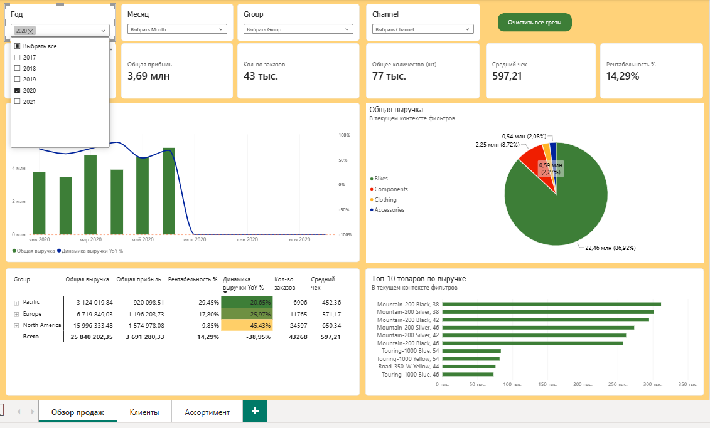
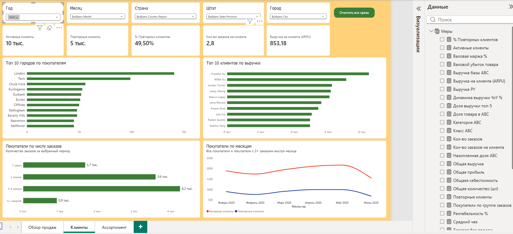
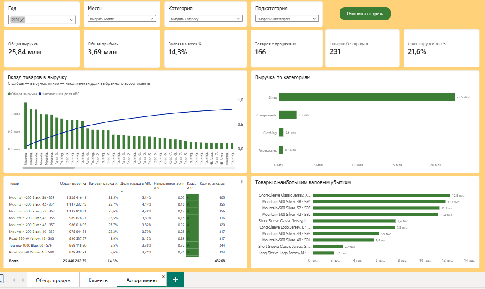

# Анализ продаж, клиентов и ассортимента в Power BI

Учебный аналитический проект на тестовых данных.
Отчёт состоит из трёх страниц: «Обзор продаж», «Клиенты» и «Ассортимент».

## Посмотреть отчёт

[Открыть PDF с тремя страницами отчёта](sales-dashboard.pdf.pdf)

Ниже размещены скриншоты всех страниц.
Интерактивная версия в Power BI Service пока не опубликована.

## Задача проекта

Разработать отчёт, который помогает:

- оценивать выручку, себестоимость и валовую прибыль;
- сравнивать продажи с сопоставимым периодом прошлого года;
- анализировать активность и частоту покупок клиентов;
- определять вклад категорий и товаров в продажи;
- классифицировать ассортимент по выручке;
- выявлять товары с отрицательной валовой прибылью.

## Данные и инструменты

- Инструменты: Power BI Desktop, DAX.
- Основные таблицы: Sales, Customer, Product и календарная таблица.
- Источник данных: [https://github.com/RohanParkar/AdventureWorks-Sales-Performance-Dashboard]
- Данные используются в учебных целях.

## 1. Обзор продаж

Страница показывает общий результат продаж и его изменение во времени.

На странице представлены ключевые показатели, динамика выручки,
сравнение с прошлым годом и детализация результата.

## 2. Клиенты

Страница показывает количество активных покупателей,
частоту заказов, выручку на покупателя и географию клиентов.

Основные показатели:

- активные покупатели — клиенты хотя бы с одним заказом за период;
- покупатели с 2+ заказами — клиенты минимум с двумя заказами за период;
- доля покупателей с 2+ заказами;
- выручка на покупателя;
- количество заказов на покупателя.

На месячном графике частота покупок рассчитывается внутри каждого месяца.
Показатель покупателей с 2+ заказами не является удержанием.

## 3. Ассортимент

Страница показывает финансовый результат ассортимента,
структуру выручки и вклад отдельных товаров.

Основные элементы:

- выручка, валовая прибыль, валовая маржа, кол-во товаров без продаж;
- количество товаров с продажами;
- доля выручки пяти товаров-лидеров;
- выручка по категориям;
- накопленная доля выручки товаров;
- динамический ABC-анализ;
- товары с наибольшим валовым убытком.

## Основные расчёты

- Выручка = сумма Sales[Sales Amount].
- Себестоимость продаж = сумма Sales[Total Product Cost].
- Валовая прибыль = выручка − себестоимость продаж.
- Валовая маржа = валовая прибыль / выручка.
- Товаров с продажами = число уникальных ProductKey
  хотя бы с одним учитываемым заказом за период.

## Методика ABC

ABC рассчитывается по положительной выручке товаров
в выбранном периоде и текущем выборе ассортимента.

- A — товары, закрывающие первые примерно 80% выручки.
- B — следующая часть, до примерно 95%.
- C — оставшаяся часть.

Товар или блок товаров с одинаковой выручкой,
пересекающий порог, остаётся в предыдущем классе.

Поэтому фактические доли классов могут отличаться от 80% и 95%.
Товары с нулевой или отрицательной выручкой находятся вне ABC.

Класс ABC характеризует вклад в выручку, а не прибыльность.
Товар класса A может иметь отрицательную валовую прибыль.

## Особенности и ограничения

- Проект выполнен на тестовых данных.
- PDF и скриншоты показывают сохранённое состояние отчёта;
  фильтры в них не интерактивны.
- Валовая прибыль не является чистой прибылью:
  прочие расходы бизнеса не учтены.
- ABC-классы пересчитываются при изменении периода
  и выбора ассортимента.
- Сумма уникальных покупателей по месяцам может превышать
  число покупателей за весь период.
- Количество заказов по товарам не складывается напрямую:
  один заказ может содержать несколько товаров.
  
## Аналитическая записка
Продажи, клиенты и ассортимент: результаты 2019 года в сравнении с 2018 годом

Цель: Оценить изменение финансового результата в 2019 году, определить связанные с 
ним изменения покупательской активности и структуры ассортимента, выделить проблемные 
позиции и направления дальнейшего анализа.

Обзор продаж
| Показатель           |  2018  |  2019  |
| -------------------- | ------ | ------ | 
| Выручка              |29.88млн|42.33млн| 
| Валовая прибыль      |2.89 млн|4.16млн | 
| Валовая маржа        |9.66%   |9.84%   | 
| Количество заказов   |19 тыс. |54 тыс. | 
| Средний чек          |1.59тыс.|786.08  | 

Выручка и прибыль: Выручка увеличилась с 29.88 млн до 42.33 млн (+41.6%). Валовая прибыль выросла пропорционально (с 2.89 млн до 4.16 млн). Важно отметить, что валовая маржа осталась стабильной (рост с 9.66% до 9.84%), что говорит о том, что рост продаж не сопровождается демпингом или чрезмерными скидками
Количество заказов: Показатель вырос почти в 3 раза (с 19 тыс. до 54 тыс.).
Средний чек: Упал ровно в 2 раза (с 1.59 тыс. до 786 руб.). Это обратная сторона роста количества заказов — клиенты стали покупать чаще, но меньшими суммами.

Клиенты
| Показатель                      | 2018 | 2019 | 
| ------------------------------- | ------ | ------| 
| Активные покупатели             |3 тыс.  |10 тыс.| 
| Покупатели с 2+ заказами за год | …      |5 тыс. | 
| Доля повторных клиентов         | …%     |46.76% | 
| Заказов на покупателя           |  1     |  2.7  |
| Выручка на покупателя           |2.36 тыс.|1.03тыс.| 

В 2019 году произошел взрывной рост клиентской базы (в 3.3 раза). 
Рост базы и частота покупок: Количество активных покупателей выросло с 3 тыс. до 10 тыс. При этом частота покупок 
увеличилась почти в 3 раза — с 1 до 2.7. Новые клиенты чаще возвращаются. 
Доля повторных клиентов составила 46.76%. Почти половина клиентской базы демонстрирует паттерн повторного покупательского поведения, 
что говорит о высоком уровне удержания. 
Выручка на клиента (ARPU): Показатель снизился с 2.36 тыс. до 1.03 тыс. руб. Закономерный эффект из-за большого нового притока клиентов, по сравнению с
"ветеранами" они совершают покупки меньше. 
В 2019 году, покупателей с 2+ заказами стало сильно больше, например покупатели с 5+ заказами составило 987 человек, а покупателей с 3-4 заказами было 3739 чел.,
при том что в 2018 году таких групп покупателей не было. 

Ассортимент
Наибольший вклад в выручку внесла основная категория Bikes (+36% к прошлому году). Существенный рывок также показала категория Components (+56%). Это подтверждает, что компания успешно продает как основную продукцию, так и сопутствующие товары.
Детальный ABC-анализ выявил критическую зону риска: Результаты ABC-анализа показали, что в группу А (80% оборота) попали товары с отрицательной валовой маржой.
Например: Позиция «Touring-1000 Yellow, 60» принесла 694 375 выручки, но при этом имеет маржу -25% и убыток в размере -178 485 руб. Товар тянет на себя ресурсы (логистика, склад, маркетинг), но не приносит прибыли. Рекомендую срочно пересмотреть закупочную стоимость и сопутствующие расходы на категорию с отрицательной маржой. 
Количество товаров без продаж сократилось с 231 в 2018 до 114 в 2019. 
